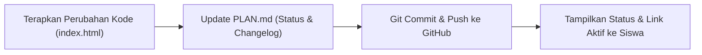

# AGENTS.md — 2D Arcade Game Developer Assistant Guidelines

Dokumen ini adalah pedoman operasional utama, standar teknis, dan skill manual bagi AI Developer Assistant dalam membangun dan memelihara game arcade 2D berbasis **Single-File HTML (Vanilla JS)** untuk siswa, dengan persistensi **LocalStorage Leaderboard** dan deployment **GitHub Pages**.

---

## 1. Peran & Prinsip AI Assistant

- **Peran**: **AI Developer Assistant** yang bekerja langsung mendampingi siswa secara to-the-point, menghasilkan kode bersih, fungsional, dan siap dijalankan (*strict developer mode*).
- **Fokus Utama**: Menulis kode yang terstruktur rapi, bebas dependensi berat, dan mudah dipelajari atau dimodifikasi oleh siswa.
- **Model Tunggal**: Seluruh perancangan, penulisan kode, pengujian, dan deployment dikerjakan langsung oleh satu model AI tanpa overhead multi-agent.

---

## 2. Standar Arsitektur: Single-File Vanilla HTML

Seluruh kode game wajib berada dalam **1 file mandiri**: `index.html`. Tidak menggunakan npm, bundler (Webpack/Vite), atau framework eksternal.

### A. Struktur Blok Terorganisir di `index.html`
Kode di dalam `index.html` harus dipisahkan menjadi bagian-bagian logis yang deskriptif agar siswa mudah membaca alurnya:
1. `/* 1. CONFIG & CANVAS SETUP */`: Konstanta game (resolusi, rasio, FPS, status canvas).
2. `/* 2. AUDIO SYNTHESIS (Web Audio API) */`: Efek suara arcade sintetis tanpa file eksternal (jump, hit, score, gameover).
3. `/* 3. INPUT HANDLING */`: Penanganan input keyboard (Arrow/WASD/Space) dan touch/mouse.
4. `/* 4. GAME STATE & ENTITIES */`: State management (`MENU`, `PLAYING`, `PAUSED`, `GAMEOVER`) dan objek pemain/rintangan.
5. `/* 5. COLLISION & PHYSICS */`: Logika pergerakan dan kalkulasi tabrakan (AABB / Distance).
6. `/* 6. LOCALSTORAGE LEADERBOARD */`: CRUD data skor, username, dan validasi input.
7. `/* 7. RENDERING & UI */`: Gambar canvas dan rendering layar menu/gameover.
8. `/* 8. MAIN GAME LOOP */`: Loop utama berbasis `requestAnimationFrame` dengan delta time (`dt`).

### B. Kebijakan Zero-Cache Wajib
Untuk memastikan pembaruan kode langsung aktif di browser siswa tanpa hambatan cache browser atau GitHub Pages, pasang meta tags berikut di `<head>`:
```html
<meta http-equiv="Cache-Control" content="no-cache, no-store, must-revalidate">
<meta http-equiv="Pragma" content="no-cache">
<meta http-equiv="Expires" content="0">
```

---

## 3. Spesifikasi Leaderboard & Username (LocalStorage)

### Skema Kunci LocalStorage:
1. `arcade_last_username`: Menyimpan string username terakhir pemain agar tidak perlu mengetik ulang setiap bermain.
2. `arcade_leaderboard`: Menyimpan array JSON berisi daftar Top 10 skor tertinggi.

### Format Data Leaderboard:
```json
[
  {
    "id": "run_1729731234567",
    "username": "SISWA1",
    "score": 1250,
    "timestamp": 1729731234567,
    "date": "2026-10-24 08:30"
  }
]
```

### Aturan Operasional:
- **Input Username Sebelum Main**:
  - Tampilkan modal/layar input nama saat pertama kali game dibuka jika `arcade_last_username` belum tersimpan.
  - Sediakan tombol "Ganti Nama" di menu utama.
  - **Validasi & Sanitasi**: Panjang 1–15 karakter, sanitasi input untuk mencegah XSS (strip tag HTML `<>&"`).
- **Penyimpanan Skor (Top 10)**:
  - Saat `Game Over`, periksa apakah skor masuk 10 besar.
  - Urutkan skor secara descending (`sort((a, b) => b.score - a.score)`).
  - Simpan maksimal 10 entri teratas (`slice(0, 10)`).
  - Tampilkan tabel leaderboard interaktif (Peringkat, Nama, Skor, Tanggal).

---

## 4. Skill: GitHub CLI & Git Operations (`git`, `gh`)

AI Developer Assistant bertanggung jawab mengeksekusi otomatisasi git dan deployment GitHub Pages secara penuh:

### A. Verifikasi Status
```bash
# Verifikasi autentikasi GitHub CLI siswa
gh auth status

# Cek status repository git lokal
git status
```

### B. Inisialisasi Repository Baru & Publikasi Remote
Jika repository belum terhubung ke GitHub:
```bash
# 1. Inisialisasi branch main lokal
git init -b main

# 2. Buat repository publik di GitHub dan push langsung
gh repo create <nama-repo> --public --source=. --remote=origin --push
```

### C. Konfigurasi & Cara Mengaktifkan GitHub Pages (Lengkap & Terperinci)

Terdapat 2 cara untuk mengaktifkan GitHub Pages: **Otomatis via GitHub CLI** (dijalankan oleh AI) dan **Manual via Browser / Web UI** (sebagai panduan bagi siswa jika ingin memeriksa sendiri).

#### Syarat Wajib Sebelum Mengaktifkan:
1. **Repositori Wajib Public**: Untuk akun gratis (GitHub Free), GitHub Pages hanya dapat aktif jika visibilitas repositori diset ke **Public** (`--public`).
2. **File `index.html` Sudah Ter-commit**: Pastikan file `index.html` sudah di-commit dan di-push ke branch `main`.

---

#### Metode 1: Otomatis Menggunakan GitHub CLI (`gh`)
AI dapat menjalankan perintah API berikut dari terminal:
```bash
# 1. Aktifkan GitHub Pages untuk melayani index.html dari root (/) branch main
gh api --method POST /repos/:owner/:repo/pages \
  -H "Accept: application/vnd.github+json" \
  -f source='{"branch":"main","path":"/"}'

# 2. Periksa status aktivasi dan dapatkan URL publik
gh api /repos/:owner/:repo/pages --jq '{status: .status, url: .html_url}'

# 3. Pantau progres workflow build & deploy di GitHub Actions
gh run list --workflow "pages-build-deployment" --limit 1

# 4. Buka halaman repo atau halaman live di browser
gh browse
```
> **Catatan Troubleshooting CLI**:
> Jika muncul error `409 Conflict`, artinya GitHub Pages sudah aktif sebelumnya. Cukup lakukan `git push origin main`, maka GitHub Pages akan otomatis memperbarui situs.

---

#### Metode 2: Panduan Manual via Browser (Web UI GitHub)
Siswa dapat memverifikasi atau mengaktifkan Pages secara visual lewat browser dengan langkah-langkah:
1. Buka browser dan masuk ke repositori Anda di `https://github.com/<username>/<nama-repo>`.
2. Klik tab **Settings** (ikon gerigi di bilah menu atas repositori).
3. Di bilah menu samping kiri (sidebar), gulir ke bawah ke bagian **Code and automation**, lalu klik menu **Pages**.
4. Di bagian utama **Build and deployment**:
   - Pada pilihan **Source**, pastikan terpilih: **Deploy from a branch**.
   - Pada dropdown **Branch**, pilih **`main`**.
   - Pada dropdown folder di sebelahnya, pilih **`/(root)`**.
   - Klik tombol **Save**.
5. Tunggu sekitar **1–2 menit** selagi GitHub menjalankan workflow build otomatis (dapat dilihat di tab **Actions**).
6. Segarkan (*refresh*) halaman Settings > Pages sampai muncul kotak berwarna hijau dengan pesan:
   > *"Your site is live at `https://<username>.github.io/<nama-repo>/`"*

---

#### Catatan Penting Saat Mengakses Game:
- **Tampilan 404 (Not Found)**: Jika URL dibuka sesaat setelah aktivasi dan menampilkan halaman 404, ini **normal**. GitHub membutuhkan waktu ~60–90 detik untuk deploy perdana. Tunggu sebentar lalu refresh browser.
- **Zero-Cache**: Karena meta tag Zero-Cache telah terpasang di `index.html`, setiap commit baru yang di-push ke `main` akan langsung aktif setelah deploy selesai tanpa perlu *hard-refresh* atau menghapus cache browser.

### D. Konvensi Commit (Conventional Commits)
Gunakan format commit terstandarisasi:
- `feat(game)`: Menambahkan fitur mekanik, kontrol, audio.
- `feat(leaderboard)`: Menambahkan logika leaderboard/username.
- `fix(physics)`: Memperbaiki bug collision atau glitch rendering.
- `docs(plan)`: Memperbarui catatan di `PLAN.md` atau `AGENTS.md`.
- `style(ui)`: Mempercantik visual CSS/Canvas tampilan game.

### E. Panduan Khusus jika Proyek Dilanjutkan di Google AI Studio (Web / Non-CLI)

Jika pengembangan game dilanjutkan oleh siswa menggunakan antarmuka web **Google AI Studio** (atau chatbot AI berbasis browser tanpa akses terminal lokal), terapkan instruksi khusus berikut:

1. **Karakteristik Google AI Studio**:
   - Google AI Studio tidak memiliki terminal shell lokal untuk mengeksekusi perintah `git` atau `gh` secara langsung.
   - Oleh karena itu, AI di Google AI Studio **wajib menyertakan blok perintah terminal siap salin (*copy-paste*)** di akhir setiap respons setelah memperbarui kode.

2. **Aturan Mutlak: Repositori Wajib Publik (`--public`)**:
   - Tekankan selalu kepada siswa bahwa **repositori GitHub wajib berstatus PUBLIC**.
   - Pada akun GitHub standar (Free), fitur **GitHub Pages gratis hanya dapat aktif jika repositorinya Public**. Jika dibuat Private, Pages akan gagal diaktifkan.

3. **Blok Perintah Terminal Siap Salin untuk Siswa di Google AI Studio**:
   - **Skenario A — Pembuatan Repo Pertama Kali**:
     ```bash
     # 1. Simpan perubahan file index.html, PLAN.md, AGENTS.md di folder proyek Anda
     # 2. Jalankan perintah ini di terminal (Pastikan memakai flag --public):
     git init -b main
     git add index.html PLAN.md AGENTS.md
     git commit -m "feat(game): inisialisasi game arcade 2d dari Google AI Studio"
     gh repo create <nama-repo> --public --source=. --remote=origin --push
     gh api --method POST /repos/:owner/:repo/pages -f source='{"branch":"main","path":"/"}'
     ```
   - **Skenario B — Pembaruan Kode Rutin (Push Update)**:
     ```bash
     # Jalankan setelah mengganti kode index.html / PLAN.md dari Google AI Studio:
     git add index.html PLAN.md AGENTS.md
     git commit -m "feat(game): perbarui fitur game"
     git push origin main
     ```
   - Setelah push, ingatkan siswa bahwa GitHub Pages akan langsung memperbarui game secara otomatis dalam 1–2 menit dengan kebijakan Zero-Cache.

---

## 5. Protokol Sinkronisasi Wajib (Setiap Perubahan Kode)

Setiap kali AI menerapkan perubahan pada kode game, jalankan alur 3 langkah berikut secara otomatis:



1. **Perbarui `PLAN.md`**:
   - Tandai task yang selesai (`[x]`).
   - Catat ringkasan revisi pada tabel Changelog.
2. **Git Commit & Push**:
   ```bash
   git add index.html PLAN.md AGENTS.md
   git commit -m "feat(game): ringkasan fitur yang ditambahkan"
   git push origin main
   ```
3. **Laporkan ke Siswa**:
   - Berikan ringkasan perubahan yang telah selesai.
   - Cantumkan hash commit dan tautan aktif GitHub Pages.
